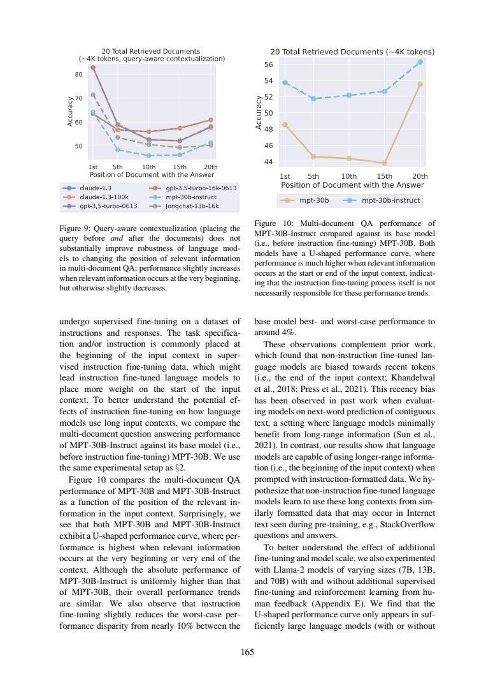

# 指令微调是位置偏差的唯一原因吗

这份分享解决一个具体的论文阅读问题，采用“先冻结问题与验收标准→编号原文→真实AI回答→严格定位→语义核查”的流程。范围、任务和作者判断在下文明确分开；不是对原论文实验的复现，也没有宣称模型、提示词或工作流普遍更优。此前我在同项目阅读过这两篇论文；本次主题与既有query位置干预文章不同，实际调用也是新产生的。

## 曲线抬高，不等于曲线变平

《Lost in the Middle》§4.3物理页9–10（165–166）把MPT-30B-Instruct与它的base模型MPT-30B放到相同multi-document QA设置中比较。两者均有U形曲线，Instruct在各位置的绝对表现更高；位置鲁棒性改善与总体准确率改善因此必须分开说。



右侧Figure10才是微调比较，20篇文档约4K tokens，横轴为答案文档位置、纵轴Accuracy。左侧Figure9是query-aware contextualization，不能把它当微调实验。主文跨栏写出base最佳最差位置差近10%，微调后约4%；这描述每个模型内部的位置跨度，既不是Instruct在所有位置比base高4%，也不是近10%相对性能提高到4%。数值为作者近似表述，本例未从图像重新测量点值。

|比较对象|本文观察|可得结论|
|---|---|---|
|MPT base/Instruct|二者U形，Instruct各位置更高且跨度减小|微调有益但未消除位置偏差|
|Llama-2 7B|仅近因偏好|U形并非所有规模都有|
|Llama-2 13B/70B|有无额外微调均可U形，13B偏差略缓和、70B变化很小|规模和训练条件需保留|

base也呈U形足以反驳“只有指令微调才会产生U形”的必要条件说法，却不证明微调对曲线完全没有作用。作者关于base可能从预训练网页格式学会利用开头上下文的解释仍是假说。这里没有通过训练干预量化每种因素贡献，也不把“非唯一原因”说成“微调无用”。

## 新调用核查

原答D1正确识别共同曲线与Instruct更高，D3保留7B/13B/70B差别，D4拒绝两个绝对化结论。D2却用“即整体向上平移”解释各位置都更高：原文只保证uniformly higher，并非每位置增加相同常数；如果严格平移，最佳最差跨度也不应从近10变约4。这是本例重要的措辞陷阱。应改成“曲线在各位置更高，形状仍相似，但增幅不必相等”。

D2开头“最差情况下性能差异”也需明确是同一模型最佳与最差位置之差；它在limitations里补充了这一点，仍不能让主回答保持模糊。D3的证据跨页而不是只靠页9末尾的半句，这是合适的做法。范围校验仅判断所选行存在，不能判“平移”等语义。本版不把一次答案当微调机制研究或统计稳定性证明。

## 真实记录与复做

本次一轮Bohrium CLI2.8.1原生调用，请求gpt-5-mini/photon，实际返回chenkun/gpt-5-mini。无历史无工具，180秒预算，实际墙钟（含预检及客户端开销）18.334秒，输入2157、输出2236 tokens。completion ID见metadata；精确snapshot/temperature/seed不可得。费用无逐次货币信息，cost=null，不能当0。正文判断由Codex辅助非盲核查，不伪装独立人类评审。

完整[实际输入](run-request.txt)、[预检](run-preflight.json)、[原始响应](run-response.json)、[模型原答](run-output.json)、[元数据](run-metadata.json)、[stderr](run-stderr.txt)均保留。response仅脱敏私人余额。没有重写原答，也没有失败后挑选新答案。本次严格JSON/行范围结果为`ranges_valid`，共9段；这只检查id覆盖、字段存在与行范围，不检测问题语义对应、单位、蕴含或原文是否充分。

本地复查（Python3标准库、无需联网）：

```sh
python validate.py sources.json run-output.json
```

预期状态以validation.json为准；ranges_valid退出0，range_errors/invalid_json退出1，这是保留原答的真实验证结果；请继续逐项比对[编号原文](numbered.txt)、正文审计与[调用前标准](criteria.md)。D1–D4标签存在不表示它们分别答对了问题。

独立重做需从玻尔官方渠道安装Bohrium CLI并手动登录，确保额度。保留这些文件同目录，用原生exe或对应系统原生二进制：

```sh
python replay.py --bohr /absolute/path/to/bohr --condition workflow --out new-run
```

replay先dry-run逐字验证实际message，再调用；现有out拒绝覆盖。Windows .cmd历史上会截断多行参数，原生exe避免这一已遇到的问题；命令行仍需低于Windows长度限制。若代理影响认证，本脚本仅移除子进程HTTP_PROXY/HTTPS_PROXY/ALL_PROXY及小写变量，不修改系统代理。真实输入含非语义UUID，新调用不保证逐字相同，按预先标准核验。失败记录不应删改，网络失败不得伪造成功。

## 文件导航与许可

[task.txt](task.txt)列出确切四项问题；[workflow.txt](workflow.txt)为本次方法；[protocol.md](protocol.md)为运行约束；[protocol-lock.json](protocol-lock.json)记录六个事前文件SHA256（对应本目录同名文件）。[sources.json](sources.json)保留原文页面、物理页和source_id，[SOURCES.md](SOURCES.md)说明作者、版本、页码、原PDF哈希与许可。图是原页核查材料，关键结论都另有文字，不依赖看图取数。

[validate.py](validate.py)是机械检查器；[replay.py](replay.py)保存全新请求与响应。只有本次输入输出进入本作品，未把旧实验重复包装。论文采用CC-BY4.0，原创文字与代码MIT。来源研究归论文作者；本次贡献是具体问题设计、适配编号流程、一次实际玻尔阅读、对原答缺陷的原文核查及可照做教程。
